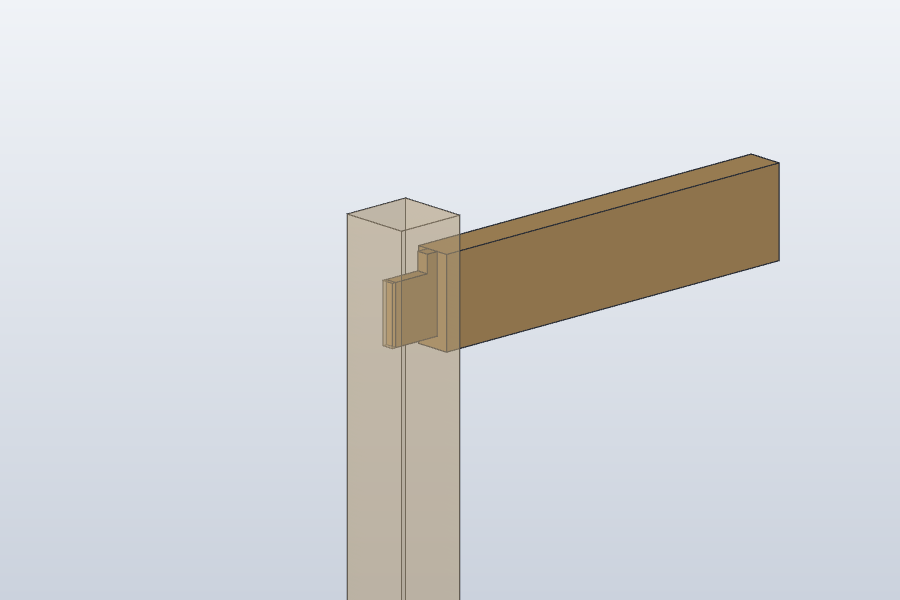
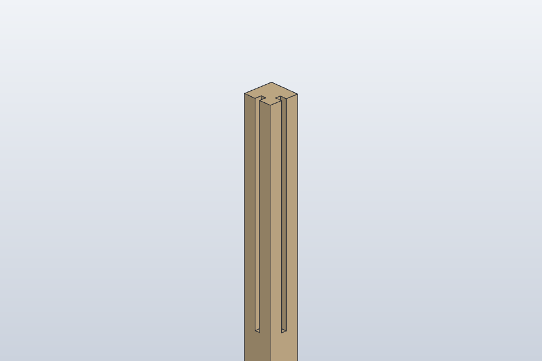
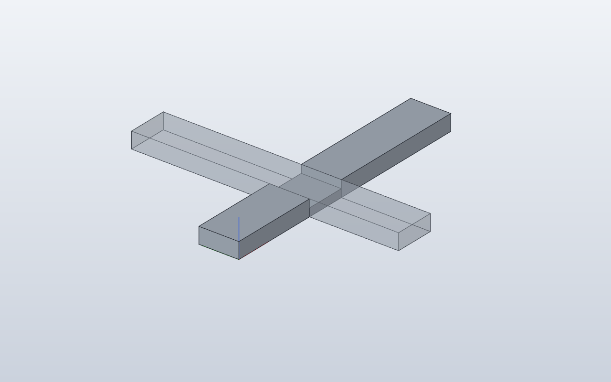
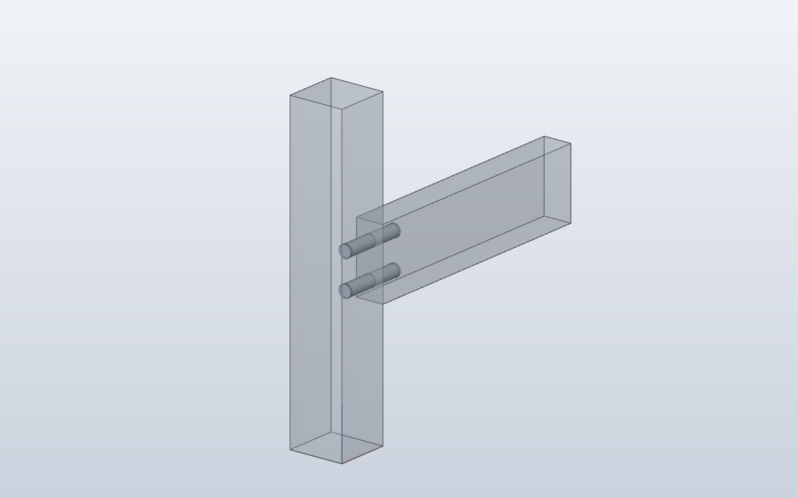
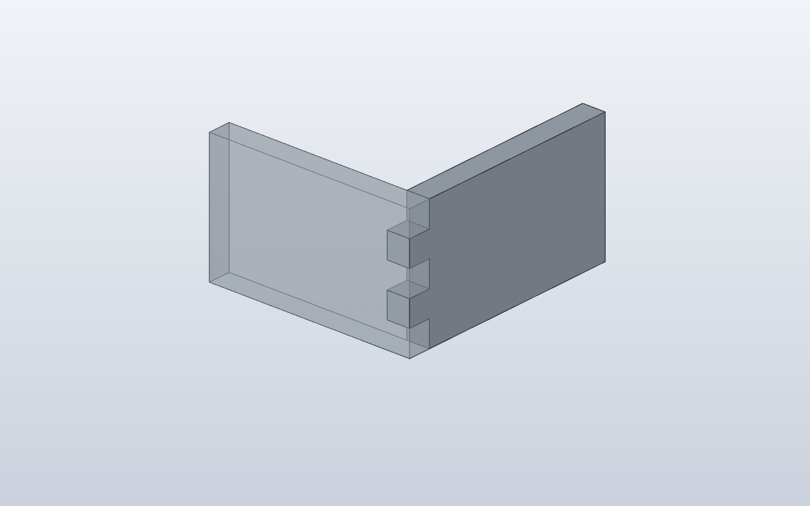

# Assemblages bois pour SolidCraft

*[English version](README.md)*

Un plugin pour [SolidCraft](https://github.com/tangency-labs/solidcraft) qui réalise des
assemblages de menuiserie. Il apporte cinq commandes : **Tenon et mortaise**, **Rainure** (et
aussi entaille et feuillure), **Mi-bois**, **Tourillons** et **Queues droites**.

Chaque commande ajoute des fonctions « boîte » et « cylindre » ordinaires dans la timeline, en une seule étape
d'annulation. Un fichier créé avec le plugin s'ouvre et se reconstruit sans lui.

## Installer

1. Téléchargez `wood-joinery-fr.zip` depuis la
   [dernière version publiée](https://github.com/WilliamHJKL/solidcraft-wood-joinery/releases/latest).
   Pour les textes en anglais, téléchargez `wood-joinery.zip`.
   Ne prenez pas les archives « Source code » : SolidCraft ne peut pas les installer.
   Vous pouvez aussi construire les paquets vous-même (voir [Construire](#construire)) ; ils sont
   alors dans `dist/`.
2. Dans SolidCraft, ouvrez Preferences › Plugins › Install plugin… et choisissez le fichier.
3. Les cinq commandes sont alors dans le menu Plugins, et dans le groupe Plugins de l'onglet Model.

Le plugin appelle trois commandes de SolidCraft, `inspect.measure`, `solid.box` et
`solid.cylinder`. Il ne demande aucun accès aux fichiers, à l'horloge ou au réseau.

N'installez qu'une seule langue : les deux paquets sont le même plugin.

## Tenon et mortaise



Saisissez le nom de la traverse et celui du montant, tels que le navigateur les affiche. Le
plugin ajoute le tenon au bout de la traverse et creuse la mortaise correspondante dans le
montant. La boîte englobante de la traverse comprend alors ses tenons : une fiche de débit lit la
vraie longueur de la pièce brute.

Le bout de la traverse doit toucher une face du montant avant de lancer la commande.

| Assemblage | Ce qu'il réalise |
|---|---|
| Classique (par défaut) | Une mortaise borgne. Le tenon a un épaulement sur chaque chant. |
| À renfort | Une mortaise borgne avec un renfort court, sur le chant de la traverse le plus proche du bout du montant. |
| Traversant | Un tenon qui traverse tout le montant. |
| Enfourchement | Une fente ouverte au bout du montant. La languette fait toute la largeur de la traverse. |

Toutes les cotes sont facultatives, en millimètres. Un champ vide suit les usages de la
menuiserie :

| Champ | Nom dans un script | Vide signifie |
|---|---|---|
| Épaisseur du tenon | `thickness` | Un tiers de l'épaisseur de la traverse |
| Longueur du tenon | `length` | Deux tiers du montant, arrondis à 5 mm. Tout le montant pour Traversant et Enfourchement |
| Épaulement | `shoulder` | La largeur de la joue, au plus un cinquième de la largeur de la traverse. Aucun pour Enfourchement |
| Largeur du renfort | `haunch_width` | Un cinquième de la largeur de la traverse |
| Profondeur du renfort | `haunch_depth` | L'épaisseur du tenon |
| Réserve de colle | `glue_relief` | 2 mm sous un tenon borgne |
| Jeu | `clearance` | Aucun |
| Décalage | `offset` | Le tenon est centré dans l'épaisseur de la traverse |

Exemple : une traverse de 18 × 45 mm contre un montant de 35 × 35 mm reçoit un tenon de
6 × 33 × 25 mm, dans une mortaise de 27 mm de profondeur.

Le plugin refuse un assemblage impossible et dit pourquoi : un tenon borgne qui traverserait le
montant, un tenon aussi épais que la traverse, une traverse qui ne touche pas le montant, un
enfourchement loin du bout du montant.

## Rainure



Saisissez le nom de la pièce et choisissez une face. La rainure suit le grand côté de cette
face, d'un bout à l'autre.

| Champ | Nom dans un script | Vide signifie |
|---|---|---|
| Face | `face` | Obligatoire : `+x`, `-x`, `+y`, `-y`, `+z` ou `-z` |
| Largeur | `width` | 6 mm |
| Profondeur | `depth` | 8 mm |
| Décalage | `offset` | Centrée. Sinon, la distance entre le bord de la face le plus proche de l'origine et la rainure. Zéro donne une feuillure |
| Arrêt au début | `stop_start` | La rainure débouche. Sinon, cette longueur de bois reste au bout le plus proche de l'origine |
| Arrêt à la fin | `stop_end` | Même chose, à l'autre bout |

Sur une face plus large que longue, la même commande réalise une entaille en travers.

## Mi-bois



Saisissez les noms de deux pièces qui se croisent. Chacune perd la moitié de son épaisseur à
l'endroit du croisement : elles se retrouvent dans le même plan. La même commande réalise un
mi-bois en croix, en T ou d'angle.

Les deux corps doivent se chevaucher dans le modèle avant de lancer la commande : dessinez
chaque pièce à sa taille complète, l'une à travers l'autre.

| Champ | Nom dans un script | Vide signifie |
|---|---|---|
| Profondeur dans la première pièce | `depth` | La moitié de l'épaisseur. La deuxième pièce perd le reste |
| Inverser les côtés | `flip` | Décoché : la première pièce est entaillée du côté opposé à l'origine |

## Tourillons



Saisissez les noms de deux pièces qui se touchent. Le plugin perce des trous en vis-à-vis dans
les deux, alignés sur le grand côté du contact, et ajoute chaque tourillon comme un nouveau
corps nommé `Dowel 1`, `Dowel 2`, etc.

| Champ | Nom dans un script | Vide signifie |
|---|---|---|
| Diamètre | `diameter` | 6, 8, 10 ou 12 mm : le plus grand qui ne dépasse pas la moitié du petit côté du contact |
| Longueur du tourillon | `length` | Cinq diamètres. Une moitié dans chaque pièce. Une pièce mince garde 3 mm sous le trou, et l'autre pièce reçoit le reste |
| Nombre de tourillons | `count` | Deux s'il y a la place, puis un tous les 96 mm environ |
| Réserve de colle | `glue_relief` | 1 mm au fond de chaque trou |
| Ajouter les tourillons | `dowel_bodies` | Coché. Décoché, seuls les trous sont percés |

Exemple : une traverse de 18 × 45 mm contre un montant de 35 × 35 mm reçoit deux tourillons de
8 × 40 mm, 20 mm dans chaque pièce, dans des trous de 21 mm de profondeur.

## Queues droites



Saisissez le nom de la pièce dont le bout touche l'autre pièce, puis le nom de cette autre
pièce. La première reçoit des queues carrées qui traversent la deuxième, et la deuxième reçoit
les entailles correspondantes. Comme pour un tenon, la première pièce mesure alors sa vraie
longueur.

| Champ | Nom dans un script | Vide signifie |
|---|---|---|
| Nombre de divisions | `count` | Queues et vides sur la largeur : le nombre impair qui donne les queues les plus carrées, 3 au minimum |
| Commencer par une queue | `swap` | Décoché : la première pièce commence par un vide, du côté le plus proche de l'origine |

Exemple : deux pièces de 18 × 100 mm reçoivent cinq divisions de 20 mm, avec deux queues sur la
première pièce.

## Limites de cette version

- Les pièces doivent être alignées sur les axes X, Y ou Z. Le plugin lit la boîte englobante de
  chaque corps : une pièce en biais n'est pas prise en charge. Les faces se désignent par leur
  axe, elles ne se cliquent pas.
- La profondeur du montant est celle de sa boîte englobante dans l'axe de l'assemblage. Un
  montant avec un pied ou un retour est donc mesuré trop profond : fixez alors vous-même la
  longueur du tenon.
- Les cotes sont des nombres. Elles ne suivent pas un paramètre : après un changement, annulez
  l'usinage et relancez la commande. Un assemblage qui se reconstruit seul attend les fonctions
  paramétriques par plugin, prévues pour une phase ultérieure du RFC des plugins de SolidCraft.
- Un tenon ne s'ajuste pas encore à une rainure déjà creusée dans la traverse ou le montant.
- Un assemblage ne voit pas les autres. Les tourillons de deux traverses posées sur deux faces
  opposées d'un montant mince peuvent se rejoindre au milieu : donnez alors une longueur plus
  courte.
- Les queues d'aronde et les coupes d'onglet manquent encore. Elles demandent des coupes en
  biais.
- Les messages d'erreur du plugin sont en anglais dans tous les paquets.

## Lancer depuis un script

Avec `solidcraft-cli`, inspectez le plugin, puis passez la valeur `approval` qu'il renvoie à
`plugin.run`. Les entrées sont `mortise-tenon`, `groove`, `half-lap`,
`dowels` et `box-joint`. Les trois dernières reçoivent les deux corps dans `first` et `second`.

```json
[{"command": "plugin.inspect", "params": {"path": "dist/wood-joinery"}}]
```

```json
[{"command": "plugin.run", "params": {
  "path": "dist/wood-joinery",
  "approval": "LA_VALEUR_APPROVAL_DE_INSPECT",
  "entry": "mortise-tenon",
  "params": {"rail": "Rail", "stile": "Stile", "variant": "haunched"}
}}]
```

```json
[{"command": "plugin.run", "params": {
  "path": "dist/wood-joinery",
  "approval": "LA_VALEUR_APPROVAL_DE_INSPECT",
  "entry": "groove",
  "params": {"body": "Leg", "face": "+x", "offset": 6, "stop_start": 80}
}}]
```

```json
[{"command": "plugin.run", "params": {
  "path": "dist/wood-joinery",
  "approval": "LA_VALEUR_APPROVAL_DE_INSPECT",
  "entry": "dowels",
  "params": {"first": "Rail", "second": "Stile", "diameter": 8, "count": 2}
}}]
```

Les noms des paramètres et les valeurs (`haunched`, `+x`…) sont les mêmes dans toutes les
langues : seuls les textes affichés sont traduits.

## Construire

Il faut Rust avec la cible `wasm32-unknown-unknown` (`rustup target add wasm32-unknown-unknown`)
et Python 3.

```sh
./build.sh
```

Le script écrit un paquet par langue : `dist/wood-joinery.zip` (anglais) et
`dist/wood-joinery-fr.zip` (français).

## Tester

```sh
cargo test                                   # le calcul de chaque usinage
tests/check.py /chemin/vers/solidcraft-cli   # le plugin emballé, dans un vrai SolidCraft
```

`tests/check.py` lance chaque commande, compare les volumes mesurés à des
valeurs calculées à la main, et vérifie l'annulation, les refus, la réouverture d'un fichier
sans le plugin, et chaque paquet traduit.

## Traduire

SolidCraft affiche les textes d'un plugin tels que son manifeste les donne, dans une seule
langue. Les textes anglais sont dans `plugin/plugin.json`. Une traduction tient en un fichier,
`plugin/locales/<langue>.json`, qui associe chaque texte anglais à sa traduction ;
`plugin/locales/fr.json` sert de modèle.

`./build.sh` écrit alors `dist/wood-joinery-<langue>.zip`. La construction échoue si un texte
n'a pas de traduction, ou si une traduction ne sert plus : une langue ne peut pas prendre de
retard.

## Licence

MIT OR Apache-2.0, comme SolidCraft. `wit/plugin.wit` est l'interface de plugin de SolidCraft
(`craft:plugin@0.1.0`), copiée de son dépôt sous la même licence.
