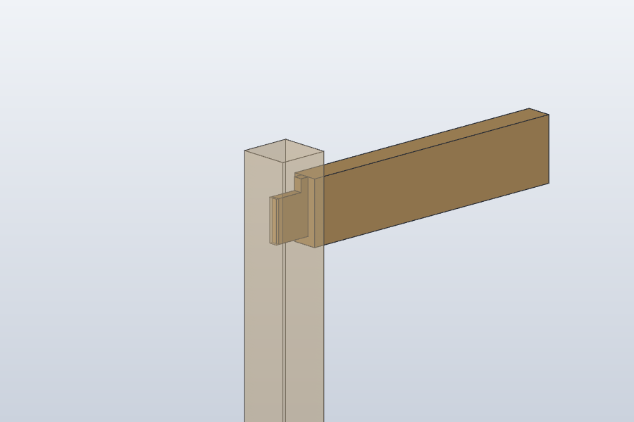
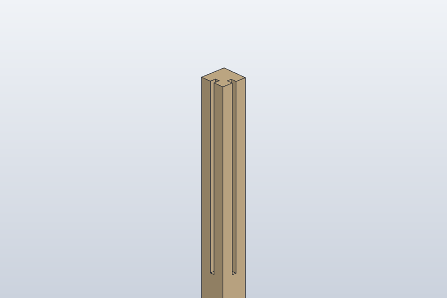

# Wood joinery for SolidCraft

*[Version française](README.fr.md)*

A plugin for [SolidCraft](https://github.com/tangency-labs/solidcraft) that makes woodworking
joints. It has two commands: **Mortise and tenon**, between two boards, and **Groove**, for a
groove, dado or rabbet in one board.

Each command adds ordinary box features to the timeline, in one undo step. A design made with
the plugin opens and rebuilds without it.

## Install

1. Download `wood-joinery.zip` from the
   [latest release](https://github.com/WilliamHJKL/solidcraft-wood-joinery/releases/latest).
   For the French texts, download `wood-joinery-fr.zip` instead.
   Do not take the "Source code" archives: SolidCraft cannot install those.
   You can also build the packages yourself (see [Build](#build)); they are then in `dist/`.
2. In SolidCraft, open Preferences › Plugins › Install plugin… and choose the file.
3. The two commands are now in the Plugins menu, and in the Plugins group of the Model tab.

The plugin calls two SolidCraft commands, `inspect.measure` and `solid.box`. It asks for no
file, clock or network access.

Install one language only: both packages are the same plugin.

## Mortise and tenon



Type the names of the rail and the stile, as the browser shows them. The plugin adds the tenon
to the end of the rail and cuts the matching mortise in the stile. The rail's bounding box then
includes its tenons, so a cut list reads the true length of the blank.

The end of the rail must touch a face of the stile before you run the command.

| Joint | What it makes |
|---|---|
| Classic (default) | A blind mortise. The tenon has a shoulder on each edge. |
| Haunched | A blind mortise with a short haunch, on the rail edge nearest the end of the stile. |
| Through | A tenon through the whole stile. |
| Bridle | An open slot at the end of the stile. The tongue runs the full width of the rail. |

Every size is optional, in millimetres. An empty field follows common cabinetmaking practice:

| Field | Script name | Empty means |
|---|---|---|
| Tenon thickness | `thickness` | A third of the rail thickness |
| Tenon length | `length` | Two thirds of the stile, to the nearest 5 mm. The whole stile for Through and Bridle |
| Shoulder | `shoulder` | The cheek width, at most a fifth of the rail width. None for Bridle |
| Haunch width | `haunch_width` | A fifth of the rail width |
| Haunch depth | `haunch_depth` | The tenon thickness |
| Glue relief | `glue_relief` | 2 mm under a blind tenon |
| Clearance | `clearance` | None |
| Offset | `offset` | The tenon is centred in the rail thickness |

Example: an 18 x 45 mm rail against a 35 x 35 mm stile gets a 6 x 33 x 25 mm tenon in a
27 mm deep mortise.

The plugin refuses a joint it cannot make, and says why: a blind tenon that would come through
the stile, a tenon as thick as the rail, a rail that does not touch the stile, a bridle away
from the end of the stile.

## Groove



Type the name of the board and choose a face. The groove runs along the longer side of that
face, from end to end.

| Field | Script name | Empty means |
|---|---|---|
| Face | `face` | Required: `+x`, `-x`, `+y`, `-y`, `+z` or `-z` |
| Width | `width` | 6 mm |
| Depth | `depth` | 8 mm |
| Offset | `offset` | Centred. Otherwise the distance from the edge of the face nearest the origin to the groove. Zero makes a rabbet |
| Stop at start | `stop_start` | The groove runs out of the board. Otherwise that much wood stays uncut at the end nearest the origin |
| Stop at end | `stop_end` | The same, at the other end |

On a face that is wider than it is long, the same command makes a dado.

## Limits of this version

- Boards must lie along the X, Y or Z axis. The plugin reads each body's bounding box, so a
  board at an angle is not supported. Faces are named by their axis, not picked.
- The stile depth is its bounding box along the joint, so a stile with a foot or a return is
  measured too deep. Set the tenon length yourself in that case.
- Sizes are numbers. They do not follow a parameter: after a change, undo the cut and run the
  command again. A joint that rebuilds by itself needs the parametric plugin features that
  SolidCraft's plugin RFC plans for a later phase.
- A tenon does not yet adjust itself to a groove already cut in the rail or the stile.
- The plugin's error messages are in English in every package.

## Run from a script

With `solidcraft-cli`, inspect the plugin, then pass the `approval` value it returns to
`plugin.run`. The entries are `mortise-tenon` and `groove`.

```json
[{"command": "plugin.inspect", "params": {"path": "dist/wood-joinery"}}]
```

```json
[{"command": "plugin.run", "params": {
  "path": "dist/wood-joinery",
  "approval": "THE_APPROVAL_FROM_INSPECT",
  "entry": "mortise-tenon",
  "params": {"rail": "Rail", "stile": "Stile", "variant": "haunched"}
}}]
```

```json
[{"command": "plugin.run", "params": {
  "path": "dist/wood-joinery",
  "approval": "THE_APPROVAL_FROM_INSPECT",
  "entry": "groove",
  "params": {"body": "Leg", "face": "+x", "offset": 6, "stop_start": 80}
}}]
```

## Build

Needs Rust with the `wasm32-unknown-unknown` target (`rustup target add wasm32-unknown-unknown`)
and Python 3.

```sh
./build.sh
```

This writes one package per language: `dist/wood-joinery.zip` (English) and
`dist/wood-joinery-fr.zip` (French).

## Test

```sh
cargo test                                   # the arithmetic of each cut
tests/check.py /path/to/solidcraft-cli       # the packed plugin in a real SolidCraft
```

`tests/check.py` runs every joint and groove, compares the measured volumes with values worked
out by hand, and checks undo, refusals, a saved design reopened without the plugin, and each
translated package.

## Translate

SolidCraft shows a plugin's texts as its manifest gives them, in one language. The English
texts are in `plugin/plugin.json`. A translation is one file, `plugin/locales/<language>.json`,
that maps each English text to its translation; `plugin/locales/fr.json` is the model.

`./build.sh` then writes `dist/wood-joinery-<language>.zip`. The build fails when a text has no
translation, or when a translation is no longer used, so a language cannot fall behind.

## Licence

MIT OR Apache-2.0, like SolidCraft. `wit/plugin.wit` is SolidCraft's plugin interface
(`craft:plugin@0.1.0`), copied from its repository under the same licence.
