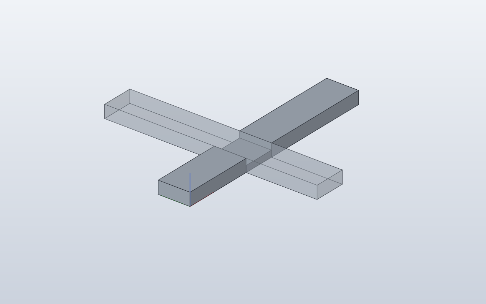
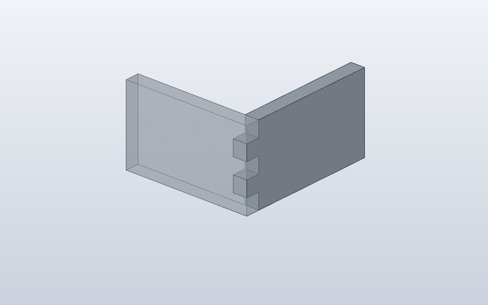

# Wood joinery for SolidCraft

*[Version française](README.fr.md)*

A plugin for [SolidCraft](https://github.com/tangency-labs/solidcraft) that makes woodworking
joints. It has five commands: **Mortise and tenon**, **Groove** (also dados and rabbets),
**Half lap**, **Dowels** and **Box joint**.

Each command adds ordinary box and cylinder features to the timeline, in one undo step. A design made with
the plugin opens and rebuilds without it.

## Install

1. Download `wood-joinery.zip` from the
   [latest release](https://github.com/WilliamHJKL/solidcraft-wood-joinery/releases/latest).
   For the French texts, download `wood-joinery-fr.zip` instead.
   Do not take the "Source code" archives: SolidCraft cannot install those.
   You can also build the packages yourself (see [Build](#build)); they are then in `dist/`.
2. In SolidCraft, open Preferences › Plugins › Install plugin… and choose the file.
3. The commands are now in the Plugins menu, and in the Plugins group of the Model tab.

The plugin calls five SolidCraft commands: `inspect.measure`, `selection.get`, `solid.box`,
`solid.cylinder` and `solid.move`. It asks for no file, clock or network access.

Install one language only: both packages are the same plugin.

## Choose the boards

Every command takes its boards in one of two ways:

- **By click.** Select the boards in the view or in the browser **before** you open the command,
  then leave the name fields empty and run it. A click made while the form is open does not
  fill the fields: SolidCraft draws the form, and a plugin cannot change it. For a joint, the board you select first is the first board (the rail
  for a mortise and tenon). A selected face or edge counts as its board.
- **By name.** Type the names as the browser shows them.

For a groove, select one flat face and leave both Board and Face empty: the groove goes in that
face.

## Align the boards first

Every joint has an **Align the boards first** box (`align` in a script). With it on, the plugin
moves the first board into place before it cuts. The second board never moves. The move and
the joint are one undo step.

| Joint | Where the first board goes |
|---|---|
| Mortise and tenon, Dowels | Against the second board: along its length when there is a gap that way, otherwise across the gap. Sideways, it moves only as far as it must to land on the second board. A board already in place does not move |
| Box joint | Its end on the second board, at the nearest end of that board, centred across the width. Each board is read by its thickness, its smallest side, so a panel may be taller than it is long |
| Half lap | Into the plane of the second board. The boards must already cross when seen from above |

With the box off, the boards must be in place already, and the plugin says so when they are not.

## Mortise and tenon


Select, or type the names of the rail and the stile, as the browser shows them. The plugin adds the tenon
to the end of the rail and cuts the matching mortise in the stile. The rail's bounding box then
includes its tenons, so a cut list reads the true length of the blank.

The end of the rail must touch a face of the stile before you run the command, unless you
tick **Align the boards first**.

The list in the form shows these values as a script takes them.

| Joint | What it makes |
|---|---|
| `classic` (default) | A blind mortise. The tenon has a shoulder on each edge. |
| `haunched` | A blind mortise with a short haunch, on the rail edge nearest the end of the stile. |
| `through` | A tenon through the whole stile. |
| `bridle` | An open slot at the end of the stile. The tongue runs the full width of the rail. |

Every size is optional, in millimetres. An empty field follows common cabinetmaking practice.
The form shows each rule in the field's title, and the fixed defaults in the fields: 2 mm of
glue relief, no clearance, no offset.

| Field | Script name | Empty means |
|---|---|---|
| Tenon thickness | `thickness` | A third of the rail thickness |
| Tenon length | `length` | Two thirds of the stile, to the nearest 5 mm. The whole stile for Through and Bridle |
| Shoulder | `shoulder` | The cheek width, at most a fifth of the rail width. None for Bridle |
| Haunch width | `haunch_width` | A fifth of the rail width |
| Haunch depth | `haunch_depth` | The tenon thickness |
| Glue relief | `glue_relief` | 2 mm under a blind tenon |
| Clearance | `clearance` | None |
| Offset | `offset` | The tenon is centred in the rail thickness |

Example: an 18 x 45 mm rail against a 35 x 35 mm stile gets a 6 x 33 x 25 mm tenon in a
27 mm deep mortise.

The plugin refuses a joint it cannot make, and says why: a blind tenon that would come through
the stile, a tenon as thick as the rail, a rail that does not touch the stile, a bridle away
from the end of the stile.

## Groove


Select, or type the name of the board and choose a face. The groove runs along the longer side of that
face, from end to end, unless you choose another **Direction**.

| Field | Script name | Empty means |
|---|---|---|
| Face | `face` | The selected face. Otherwise `+x`, `-x`, `+y`, `-y`, `+z` or `-z` |
| Direction | `along` | The groove runs along the longer side of the face. Otherwise the axis it runs along: `x`, `y` or `z` |
| Width | `width` | 6 mm |
| Depth | `depth` | 8 mm |
| Offset | `offset` | Centred. Otherwise the distance from the edge of the face nearest the origin to the groove. Zero makes a rabbet |
| Stop at start | `stop_start` | The groove runs out of the board. Otherwise that much wood stays uncut at the end nearest the origin |
| Stop at end | `stop_end` | The same, at the other end |

On a face that is wider than it is long, the same command makes a dado.

## Half lap



Select, or type the names of two boards that cross. Each loses half its thickness where they overlap, so
they end up in one plane. The same command makes a cross lap, a T lap and a corner lap.

The two bodies must overlap in the model before you run the command: draw each board at its
full size, one through the other. **Align the boards first** brings a board that lies above or
below the other into the same plane.

| Field | Script name | Empty means |
|---|---|---|
| Depth in the first board | `depth` | Half the thickness. The second board loses the rest |
| Swap sides | `flip` | Off: the first board is cut on its side away from the origin |

## Dowels


Select, or type the names of two boards that touch. The plugin drills matching holes in both, in a row
along the longer side of the contact, and adds each dowel as a new body named `Dowel 1`,
`Dowel 2` and so on.

| Field | Script name | Empty means |
|---|---|---|
| Diameter | `diameter` | 6, 8, 10 or 12 mm: the largest that is at most half the thinner side of the contact |
| Dowel length | `length` | Five diameters. Half goes in each board. A thin board keeps 3 mm under the hole, and the other board takes the rest |
| Number of dowels | `count` | Two when there is room, then one every 96 mm or so |
| Glue relief | `glue_relief` | 1 mm at the bottom of each hole |
| Add the dowels | `dowel_bodies` | On. Off drills the holes only |

Example: an 18 x 45 mm rail against a 35 x 35 mm stile gets two 8 x 40 mm dowels, 20 mm in each
board, in holes 21 mm deep.

## Box joint



Select, or type the name of the board whose end touches the other board, then the name of that other
board. The first board gets square fingers that go through the second one, and the second one
gets the matching sockets. As with a tenon, the first board then measures its true length.

| Field | Script name | Empty means |
|---|---|---|
| Number of divisions | `count` | Fingers and gaps across the width: the odd number that makes them nearest to square, at least 3 |
| Start with a finger | `swap` | Off: the first board starts with a gap at the edge nearest the origin |

Example: two 18 x 100 mm boards get five divisions of 20 mm, with two fingers on the first board.

## Limits of this version

- Boards must lie along the X, Y or Z axis. The plugin reads each body's bounding box, so a
  board at an angle is not supported. A face picked for a groove must be square to an axis too.
- The stile depth is its bounding box along the joint, so a stile with a foot or a return is
  measured too deep. Set the tenon length yourself in that case.
- Sizes are numbers. They do not follow a parameter: after a change, undo the cut and run the
  command again. A joint that rebuilds by itself needs the parametric plugin features that
  SolidCraft's plugin RFC plans for a later phase.
- Work with the top component active. A board in a component that was turned or moved is not
  supported yet: turn the body itself, not its component. The plugin checks where each joint
  landed, and when it is not where it was planned it changes nothing and says so.
- A tenon does not yet adjust itself to a groove already cut in the rail or the stile.
- A joint does not see the other joints. Dowels from two rails on opposite faces of a thin
  stile can meet in the middle: give a shorter length in that case.
- Dovetails and miters are not there yet. They need cuts at an angle.
- The plugin's error messages are in English in every package.

## Run from a script

With `solidcraft-cli`, inspect the plugin, then pass the `approval` value it returns to
`plugin.run`. The entries are `mortise-tenon`, `groove`, `half-lap`,
`dowels` and `box-joint`. The last three take the two bodies as `first` and `second`.
A script may leave the bodies out and set the selection with `select.set` first.

```json
[{"command": "plugin.inspect", "params": {"path": "dist/wood-joinery"}}]
```

```json
[{"command": "plugin.run", "params": {
  "path": "dist/wood-joinery",
  "approval": "THE_APPROVAL_FROM_INSPECT",
  "entry": "mortise-tenon",
  "params": {"rail": "Rail", "stile": "Stile", "variant": "haunched"}
}}]
```

```json
[{"command": "plugin.run", "params": {
  "path": "dist/wood-joinery",
  "approval": "THE_APPROVAL_FROM_INSPECT",
  "entry": "groove",
  "params": {"body": "Leg", "face": "+x", "offset": 6, "stop_start": 80}
}}]
```

```json
[{"command": "plugin.run", "params": {
  "path": "dist/wood-joinery",
  "approval": "THE_APPROVAL_FROM_INSPECT",
  "entry": "dowels",
  "params": {"first": "Rail", "second": "Stile", "diameter": 8, "count": 2}
}}]
```

## Build

Needs Rust with the `wasm32-unknown-unknown` target (`rustup target add wasm32-unknown-unknown`)
and Python 3.

```sh
./build.sh
```

This writes one package per language: `dist/wood-joinery.zip` (English) and
`dist/wood-joinery-fr.zip` (French).

## Test

```sh
cargo test                                   # the arithmetic of each cut
tests/check.py /path/to/solidcraft-cli       # the packed plugin in a real SolidCraft
```

`tests/check.py` runs every command, compares the measured volumes with values worked
out by hand, and checks undo, refusals, a saved design reopened without the plugin, and each
translated package.

## Translate

SolidCraft shows a plugin's texts as its manifest gives them, in one language. The English
texts are in `plugin/plugin.json`. A translation is one file, `plugin/locales/<language>.json`,
that maps each English text to its translation; `plugin/locales/fr.json` is the model.
The values of a choice are translated too. A translated value ends with the script value in
brackets, as in `à renfort (haunched)`: the plugin reads the brackets.

`./build.sh` then writes `dist/wood-joinery-<language>.zip`. The build fails when a text has no
translation, or when a translation is no longer used, so a language cannot fall behind.

## Licence

MIT OR Apache-2.0, like SolidCraft. `wit/plugin.wit` is SolidCraft's plugin interface
(`craft:plugin@0.1.0`), copied from its repository under the same licence.
