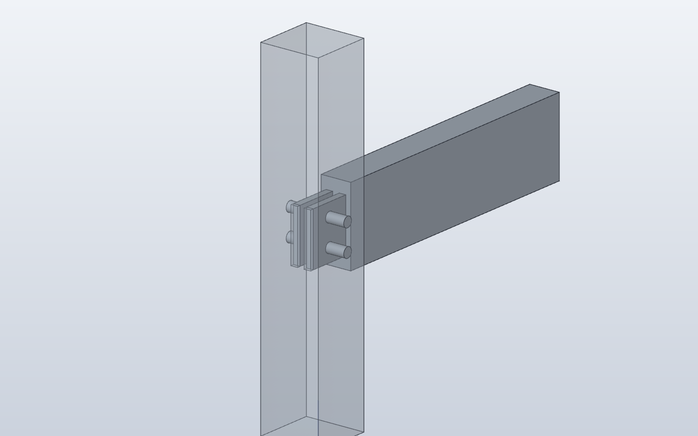
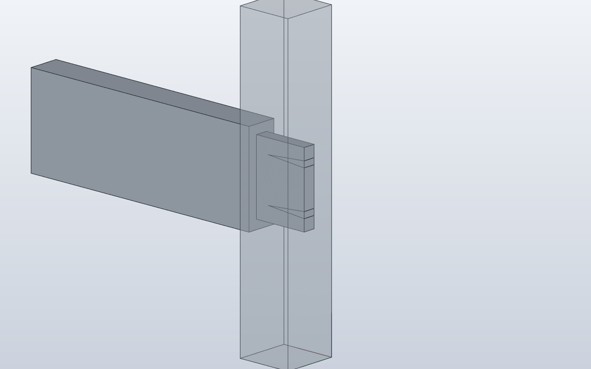
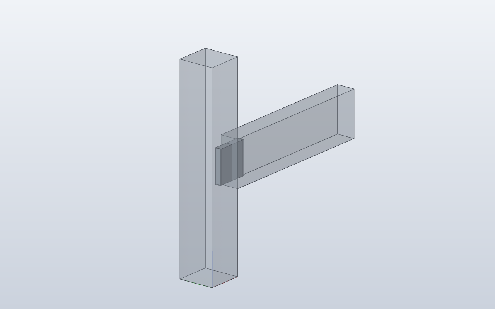
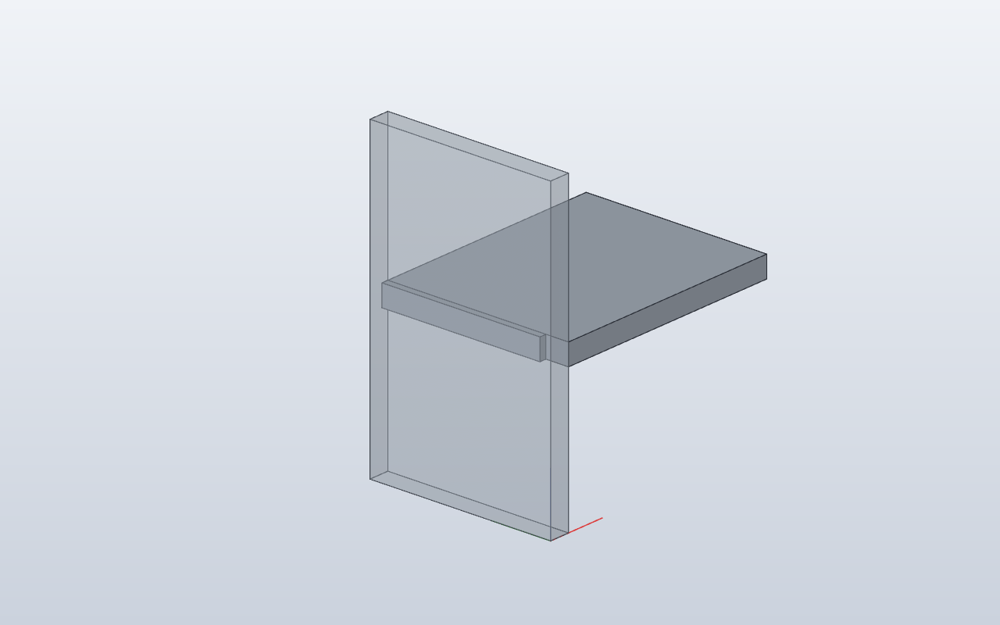
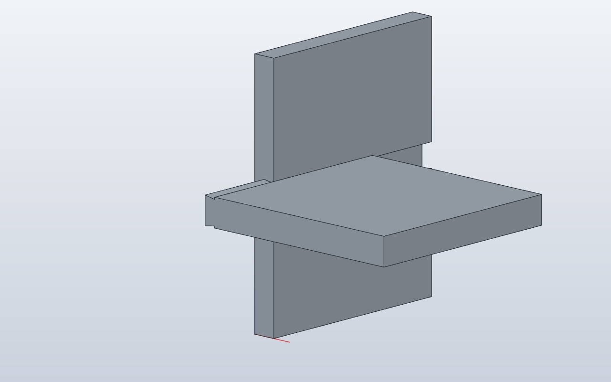
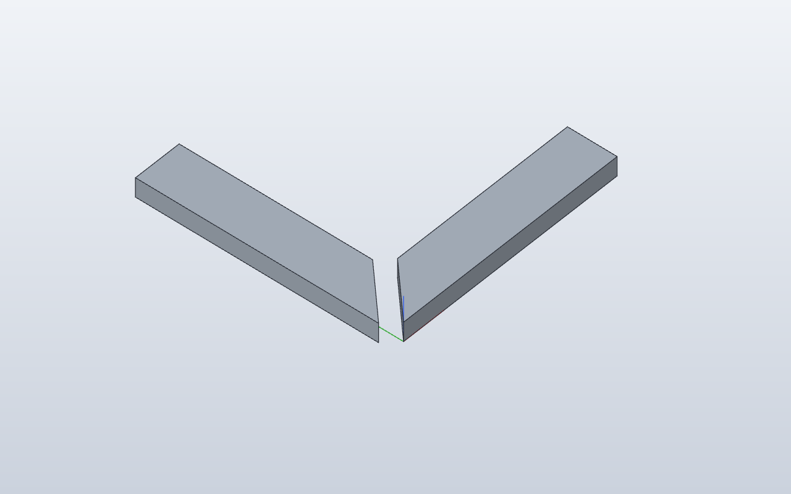
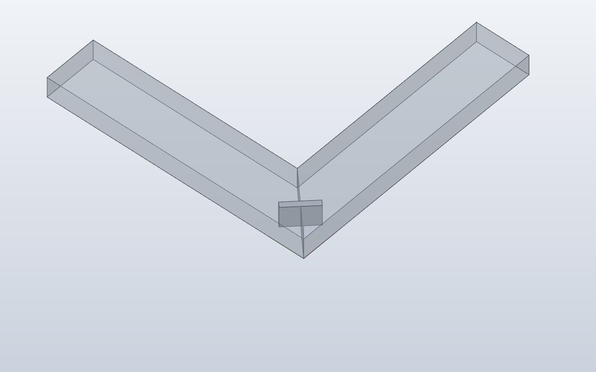
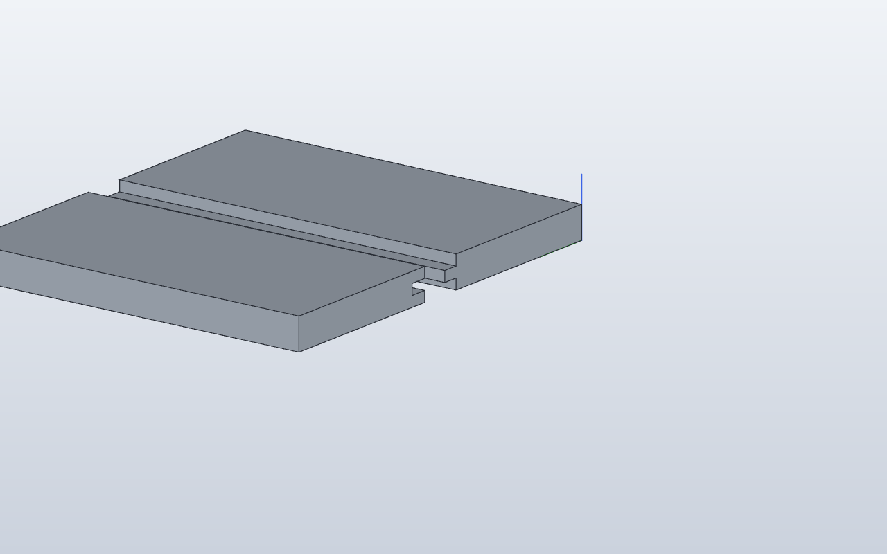
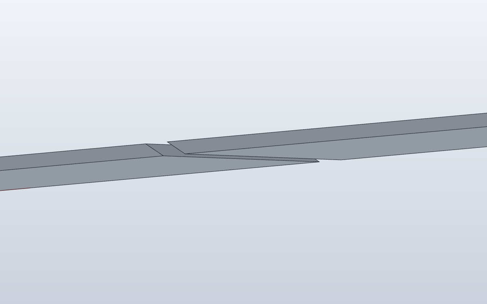
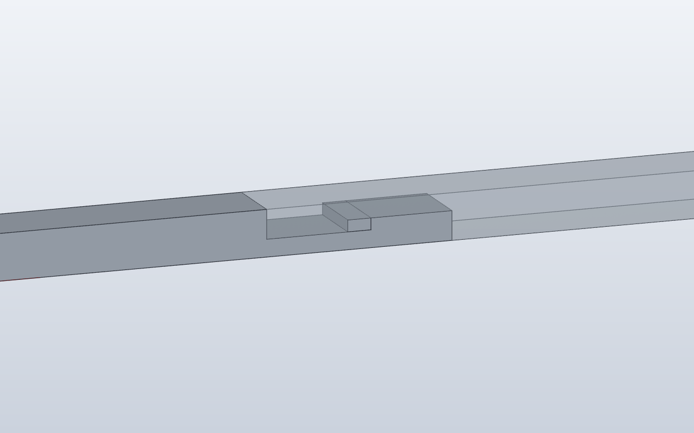

# Wood joinery for SolidCraft

*[Version française](README.fr.md)*

A plugin for [SolidCraft](https://github.com/tangency-labs/solidcraft) that makes woodworking
joints. It has thirteen commands: **Mortise and tenon**, **Groove** (also dados and rabbets),
**Half lap**, **Dowels**, **Box joint**, **Loose tenon**, **Housing**, **Miter**, **Tongue and
groove**, **Scarf joint**, **Dovetails**, **Screws** and **Biscuits**.

Each command adds ordinary features to the timeline (boxes, cylinders, moves and cuts), in one
undo step. A design made with the plugin opens and rebuilds without it.

## Install

You need the SolidCraft desktop application, version 0.42.0 or later. The web version runs no
plugins.

1. **Download the package.** Open the
   [latest release](https://github.com/WilliamHJKL/solidcraft-wood-joinery/releases/latest) and,
   under *Assets*, download one file:
   - `wood-joinery-en.zip` for the English texts;
   - `wood-joinery-fr.zip` for the French texts.

   Do not take the two "Source code" archives: SolidCraft cannot install those. Do not unzip
   the file.
2. **Install it.** In SolidCraft, open *Preferences › Plugins*, click *Install plugin…* and
   choose the file you downloaded.
3. **Confirm.** SolidCraft shows the plugin's name, its version and what it asks for. The
   plugin asks to run seven SolidCraft commands: `inspect.measure`, `selection.get`, `solid.box`,
   `solid.cylinder`, `solid.cone`, `solid.move` and `solid.combine`. It asks for no file, clock or network
   access. Accept.
4. **Find the commands.** They are in the *Plugins* group of the *Model* tab. From SolidCraft
   0.44, each command has its own icon there. SolidCraft 0.42 and 0.43 show a generic icon, and
   also list the commands in the *Plugins* menu, next to *File*. Open a design, select two
   boards, then choose a command.

Install one language only: both packages are the same plugin, with the same id.

**Update.** In *Preferences › Plugins*, click *Remove* on the *Wood joinery* card, then install
the new file as above. Your designs keep their joints: they are ordinary features.

**Uninstall.** In *Preferences › Plugins*, click *Remove* on the plugin's card. The switch on
the same card turns the plugin off without removing it.

**If something goes wrong.**

- *SolidCraft refuses the file*: you took a "Source code" archive, or you unzipped the package.
  Download `wood-joinery-en.zip` or `wood-joinery-fr.zip` again from *Assets*.
- *The Plugins menu shows no command*: check that the plugin's switch is on in
  *Preferences › Plugins*.
- *A form says "This entry needs to be run from the agent or CLI"*: the plugin is older than
  0.4.3. Remove it and install the latest release.

You can also build the packages yourself (see [Build](#build)); they are then in `dist/`.

## Choose the boards

Every command takes its boards in one of two ways:

- **By click.** Select the boards in the view or in the browser **before** you open the command,
  then leave the name fields empty and run it. A click made while the form is open does not
  fill the fields: SolidCraft draws the form, and a plugin cannot change it. For a joint, the board you select first is the first board (the rail
  for a mortise and tenon). A selected face or edge counts as its board.
- **By name.** Type the names as the browser shows them.

For a groove, select one flat face and leave both Board and Face empty: the groove goes in that
face.

## Align the boards first

Every joint has an **Align the boards first** box (`align` in a script). With it on, the plugin
moves the first board into place before it cuts. The second board never moves. The move and
the joint are one undo step.

| Joint | Where the first board goes |
|---|---|
| Mortise and tenon, Dowels | Against the second board: along its length when there is a gap that way, otherwise across the gap. Sideways, it moves only as far as it must to land on the second board. A board already in place does not move |
| Box joint, Dovetails, Miter | Its end on the second board, at the nearest end of that board, centred across the width. Each board is read by its thickness, its smallest side, so a panel may be taller than it is long |
| Half lap | Into the plane of the second board. The boards must already cross when seen from above |

With the box off, the boards must be in place already, and the plugin says so when they are not.

## Mortise and tenon


Select, or type the names of the rail and the stile, as the browser shows them. The plugin adds the tenon
to the end of the rail and cuts the matching mortise in the stile. The rail's bounding box then
includes its tenons, so a cut list reads the true length of the blank.

The end of the rail must touch a face of the stile before you run the command, unless you
tick **Align the boards first**.

The list in the form shows these values as a script takes them.

| Joint | What it makes |
|---|---|
| `classic` (default) | A blind mortise. The tenon has a shoulder on each edge. |
| `haunched` | A blind mortise with a short haunch, on the rail edge nearest the end of the stile. |
| `through` | A tenon through the whole stile. |
| `bridle` | An open slot at the end of the stile. The tongue runs the full width of the rail. |

Every size is optional, in millimetres. An empty field follows common cabinetmaking practice.
The form shows each rule in the field's title, and the fixed defaults in the fields: 2 mm of
glue relief, no clearance, no offset.

| Field | Script name | Empty means |
|---|---|---|
| Tenon thickness | `thickness` | A third of the rail thickness |
| Tenon length | `length` | Two thirds of the stile, to the nearest 5 mm. The whole stile for Through and Bridle |
| Shoulder | `shoulder` | The cheek width, at most a fifth of the rail width. None for Bridle |
| Haunch width | `haunch_width` | A fifth of the rail width |
| Haunch depth | `haunch_depth` | The tenon thickness |
| Glue relief | `glue_relief` | 2 mm under a blind tenon |
| Clearance | `clearance` | None |
| Offset | `offset` | The tenon is centred in the rail thickness |
| Double tenon | `double` | Off. On: two tenons side by side across the rail, each a fifth of its thickness, each in its own mortise |
| Tenon position | `position` | `centre`. `low` or `high` puts the tenon level with a face of the rail (a bare-faced tenon). The stile must then be wider than the rail on that side |
| Pegs through the tenon | `pegs` | 0. Otherwise 1 or 2 pegs through the stile and the tenon, half way along the tenon. Each peg is a new body named `Peg 1`, `Peg 2`… |
| Peg diameter | `peg_diameter` | 6 mm, 8 mm when the tenon is 30 mm long or more |
| Wedges in a through tenon | `wedges` | 0. Otherwise 1 or 2 wedges in the end of a `through` tenon, three quarters of its length deep. Each wedge is a new body named `Wedge 1`, `Wedge 2`… A script may set `wedge_thickness`, 4 mm by default |

Example: an 18 x 45 mm rail against a 35 x 35 mm stile gets a 6 x 33 x 25 mm tenon in a
27 mm deep mortise.





A wedge does not spread the wood in the model: it fills a slot of its own shape in the end of
the tenon, so the volumes stay true. The mortise is not flared.

The plugin refuses a joint it cannot make, and says why: a blind tenon that would come through
the stile, a tenon as thick as the rail, a rail that does not touch the stile, a bridle away
from the end of the stile.

## Groove


Select, or type the name of the board and choose a face. The groove runs along the longer side of that
face, from end to end, unless you choose another **Direction**.

| Field | Script name | Empty means |
|---|---|---|
| Face | `face` | The selected face. Otherwise `+x`, `-x`, `+y`, `-y`, `+z` or `-z` |
| Direction | `along` | The groove runs along the longer side of the face. Otherwise the axis it runs along: `x`, `y` or `z` |
| Width | `width` | 6 mm |
| Depth | `depth` | 8 mm |
| Offset | `offset` | Centred. Otherwise the distance from the edge of the face nearest the origin to the groove. Zero makes a rabbet |
| Stop at start | `stop_start` | The groove runs out of the board. Otherwise that much wood stays uncut at the end nearest the origin |
| Stop at end | `stop_end` | The same, at the other end |

On a face that is wider than it is long, the same command makes a dado.

## Half lap


Select, or type the names of two boards that cross. Each loses half its thickness where they overlap, so
they end up in one plane. The same command makes a cross lap, a T lap and a corner lap.
Boards standing on edge that cross, as in an egg-crate divider, each lose half their height
instead. Two boards along the same line make an end lap: overlap their ends by the length of
the lap (often the width of the boards); they are notched through their thickness.

The two bodies must overlap in the model before you run the command: draw each board at its
full size, one through the other. **Align the boards first** brings a board that lies above or
below the other into the same plane.

| Field | Script name | Empty means |
|---|---|---|
| Depth in the first board | `depth` | Half the thickness. The second board loses the rest |
| Swap sides | `flip` | Off: the first board is cut on its side away from the origin |

## Dowels


Select, or type the names of two boards that touch. The plugin drills matching holes in both, in a row
along the longer side of the contact, and adds each dowel as a new body named `Dowel 1`,
`Dowel 2` and so on.

| Field | Script name | Empty means |
|---|---|---|
| Diameter | `diameter` | 6, 8, 10 or 12 mm: the largest that is at most half the thinner side of the contact |
| Dowel length | `length` | Five diameters. Half goes in each board. A thin board keeps 3 mm under the hole, and the other board takes the rest |
| Number of dowels | `count` | Two when there is room, then one every 96 mm or so |
| Glue relief | `glue_relief` | 1 mm at the bottom of each hole |
| Add the dowels | `dowel_bodies` | On. Off drills the holes only |

Example: an 18 x 45 mm rail against a 35 x 35 mm stile gets two 8 x 40 mm dowels, 20 mm in each
board, in holes 21 mm deep.

## Box joint


Select, or type the name of the board whose end touches the other board, then the name of that other
board. The first board gets square fingers that go through the second one, and the second one
gets the matching sockets. As with a tenon, the first board then measures its true length.

| Field | Script name | Empty means |
|---|---|---|
| Number of divisions | `count` | Fingers and gaps across the width: the odd number that makes them nearest to square, at least 3 |
| Start with a finger | `swap` | Off: the first board starts with a gap at the edge nearest the origin |

Example: two 18 x 100 mm boards get five divisions of 20 mm, with two fingers on the first board.

## Loose tenon



Select, or type the names of two boards that touch. The plugin cuts matching mortises in both,
and adds each loose tenon as a new body named `Loose tenon 1`, `Loose tenon 2` and so on.

| Field | Script name | Empty means |
|---|---|---|
| Tenon thickness | `thickness` | 5, 6, 8 or 10 mm: the largest that is at most a third of the thinner side of the contact |
| Tenon width | `width` | The width of the joint, less a shoulder on each side |
| Tenon length | `length` | Five thicknesses, rounded up to 10 mm. Half goes in each board. A thin board keeps 3 mm under the mortise, and the other board takes the rest |
| Number of tenons | `count` | One, then one every 120 mm or so |
| Glue relief | `glue_relief` | 1 mm at the bottom of each mortise |
| Add the tenons | `tenon_bodies` | On. Off cuts the mortises only |

Example: an 18 x 45 mm rail against a 35 x 35 mm stile gets one 6 x 33 x 30 mm tenon, 15 mm in
each board, in mortises 16 mm deep.

## Housing



Select, or type the name of the shelf, then the name of the side panel. The end of the shelf
must touch a face of the side. The plugin cuts a housing as wide as the shelf is thick, and
makes the shelf longer by the depth of the housing, so it measures its true length.

| Field | Script name | Empty means |
|---|---|---|
| Depth | `depth` | A third of the side, to the nearest millimetre |
| Stop at start | `stop_start` | The housing runs out of the side. Otherwise that much wood stays uncut at the end nearest the origin |
| Stop at end | `stop_end` | The same, at the other end |
| Dovetail slope 1:N | `slope` | 0: a square housing. Otherwise a sliding dovetail: the tongue widens into the side at that slope, 6 for 1:6 |

Example: an 18 mm shelf goes 6 mm into an 18 mm side.



A sliding dovetail holds the side against the shelf. At 1:6 and 6 mm deep, the tongue is 18 mm
wide at the bottom and 16 mm at the neck.

## Miter



Select, or type the names of two boards that meet at a corner. Each is cut along the plane that
runs from the outer corner to the inner one: at 45 degrees when the boards are equally thick,
at another angle when they are not.

The boards may be drawn through each other at the corner, or one may stop at the other: that
one is first made to reach the outer corner. The command works for boards on edge, as the sides
of a box, and for boards lying flat, as the sides of a picture frame.

Each cut adds three features to the timeline: a tool box, the move that turns it, and the cut.

| Field | Script name | Empty means |
|---|---|---|
| Spline thickness | `spline` | 0: no spline. Otherwise a loose spline of that thickness across the cut, half way along it. It is a new body named `Miter spline 1`… |
| Spline depth in each board | `spline_depth` | A third of the thinner board |



## Tongue and groove



Select, or type the names of two boards that touch edge to edge. The first board gets a tongue
along the whole edge, the second one the matching groove.

| Field | Script name | Empty means |
|---|---|---|
| Tongue thickness | `thickness` | A third of the thickness of the boards. The tongue is centred |
| Tongue length | `depth` | Half the thickness of the boards, to the nearest millimetre, at most 10 mm |
| Glue relief | `glue_relief` | 1 mm at the bottom of the groove |

Example: two 18 mm boards get a 6 x 9 mm tongue in a groove 10 mm deep.

## Scarf joint



Select, or type the names of two boards that run the same way and overlap, end over end. Each
is cut along one slope that runs over the whole overlap, from one face to the other. The length
of the overlap sets the slope: eight thicknesses give 1:8.

| Field | Script name | Empty means |
|---|---|---|
| Turn the slope over | `flip` | Off: the slope starts on the face away from the origin |
| Tabled, with a key | `key` | Off: one plain slope. On: a tabled scarf, see below |

With **Align the boards first**, the first board is moved so that the two overlap by eight
thicknesses, level across their width and thickness.



A tabled scarf has two steps in place of the slope. Each board keeps a hook, 3/8 of the
thickness up to the middle of the overlap and 5/8 past it, and a key fills the step between
the two hooks: it stops the boards from pulling apart. The key is a new body named
`Scarf key 1`. It is half a thickness long; a script may set `key_width`. The overlap must be
three thicknesses or more. The ends are cut square, not squinted.

## Dovetails


Select, or type the name of the tail board, whose end touches the other board, then the name of
the pin board. The tail board gets tails that go through the pin board, and the pin board gets
the matching sockets, with a half pin at each edge. Give a **Lap** for half-blind dovetails.

| Field | Script name | Empty means |
|---|---|---|
| Number of tails | `count` | One every two and a half thicknesses or so |
| Slope 1:N | `slope` | 8, the usual hardwood slope. Use 6 for softwood |
| Pin width | `pin` | Half the thickness of the tail board, at the narrow end of a pin |
| Lap | `lap` | 0: through dovetails. Otherwise the wood left in front of the tails, for half-blind dovetails |

Example: two 18 x 100 mm boards get two tails, 41 mm wide at the end and 36.5 mm at the base,
between pins 9 mm wide at their narrow end.

Each tail adds nine features to the timeline: the tail is first made as a body of its own, its
two sides are cut at the slope, then it cuts its socket and joins the tail board.

## Screws

Select, or type the name of the board the screw goes through, then the name of the board it
bites into. The two must touch. The plugin drills a clearance hole through the first board,
with a countersink for the head, and a pilot hole in the second one. It adds no screw body.

| Field | Script name | Empty means |
|---|---|---|
| Screw diameter | `diameter` | 4 mm. The clearance hole is 0.5 mm wider, the pilot hole 0.7 of the screw |
| Screw length | `length` | Two and a half times the first board, to the nearest 5 mm |
| Number of screws | `count` | One, two from 60 mm, then one every 150 mm or so |
| Countersink the heads | `countersink` | On: a 90 degree countersink as wide as two diameters |

Example: an 18 mm side on a shelf end gets two 4 x 45 mm screws: 4.5 mm holes countersunk to
8 mm, and 3 mm pilot holes 27 mm deep.

## Biscuits

Select, or type the names of two boards that touch. The plugin cuts in each board the slot that
the 100 mm blade of a biscuit joiner leaves, 4 mm thick, and adds each biscuit as a new body
named `Biscuit 1`, `Biscuit 2` and so on.

| Field | Script name | Empty means |
|---|---|---|
| Biscuit size | `size` | 20. Sizes 0, 10 and 20 go 8, 10 and 12 mm into each board |
| Number of biscuits | `count` | One every 150 mm or so |
| Add the biscuits as bodies | `biscuit_bodies` | On. Off cuts the slots only |

The boards must be at least 10 mm thick where they touch.

## Limits of this version

- Boards must lie along the X, Y or Z axis. The plugin reads each body's bounding box, so a
  board at an angle is not supported. A face picked for a groove must be square to an axis too.
- The stile depth is its bounding box along the joint, so a stile with a foot or a return is
  measured too deep. Set the tenon length yourself in that case.
- Sizes are numbers. They do not follow a parameter: after a change, undo the cut and run the
  command again. A joint that rebuilds by itself needs the parametric plugin features that
  SolidCraft's plugin RFC plans for a later phase.
- Work with the top component active. A board in a component that was turned or moved is not
  supported yet: turn the body itself, not its component. The plugin checks where each joint
  landed, and when it is not where it was planned it changes nothing and says so.
- A tenon does not yet adjust itself to a groove already cut in the rail or the stile.
- A joint does not see the other joints. Dowels from two rails on opposite faces of a thin
  stile can meet in the middle: give a shorter length in that case. Two boards already joined
  by tenons, fingers or tails can take dowels, screws or biscuits: they are read as touching
  on the face that the first board enters.
- A tabled scarf has square ends and one plain key, not a pair of folding wedges. A miter is cut across the whole board.
- The cuts at an angle add many features: six for a miter or a scarf, nine for each dovetail.
- SolidCraft stops a plugin command after 30 seconds. So one call makes at most 30 dowels,
  30 biscuits, 40 loose tenons, 15 screws, 20 dovetails or 60 box joint divisions. Above that,
  the command refuses and changes nothing. A count worked out from the length stops at the same
  number: on a very long joint, the pieces are further apart.
- The plugin's error messages are in English in every package.

## Run from a script

With `solidcraft-cli`, inspect the plugin, then pass the `approval` value it returns to
`plugin.run`. The entries are `mortise-tenon`, `groove`, `half-lap`,
`dowels`, `box-joint`, `loose-tenon`, `housing`, `miter`, `tongue-groove`, `scarf`, `dovetail`,
`screws` and `biscuits`.
All but the first two take the two bodies as `first` and `second`.
A script may leave the bodies out and set the selection with `select.set` first.

```json
[{"command": "plugin.inspect", "params": {"path": "dist/wood-joinery"}}]
```

```json
[{"command": "plugin.run", "params": {
  "path": "dist/wood-joinery",
  "approval": "THE_APPROVAL_FROM_INSPECT",
  "entry": "mortise-tenon",
  "params": {"rail": "Rail", "stile": "Stile", "variant": "haunched"}
}}]
```

```json
[{"command": "plugin.run", "params": {
  "path": "dist/wood-joinery",
  "approval": "THE_APPROVAL_FROM_INSPECT",
  "entry": "groove",
  "params": {"body": "Leg", "face": "+x", "offset": 6, "stop_start": 80}
}}]
```

```json
[{"command": "plugin.run", "params": {
  "path": "dist/wood-joinery",
  "approval": "THE_APPROVAL_FROM_INSPECT",
  "entry": "dowels",
  "params": {"first": "Rail", "second": "Stile", "diameter": 8, "count": 2}
}}]
```

## Build

Needs Rust with the `wasm32-unknown-unknown` target (`rustup target add wasm32-unknown-unknown`)
and Python 3.

```sh
./build.sh
```

This writes one package per language: `dist/wood-joinery-en.zip` (English) and
`dist/wood-joinery-fr.zip` (French).

## Test

```sh
cargo test                                   # the arithmetic of each cut
tests/check.py /path/to/solidcraft-cli       # the packed plugin in a real SolidCraft
tests/shapes.py /path/to/solidcraft-cli      # every joint, its boards turned 12 ways, makes the same joint
```

`tests/check.py` runs every command, compares the measured volumes with values worked
out by hand, and checks undo, refusals, a saved design reopened without the plugin, and each
translated package.

## Translate

SolidCraft shows a plugin's texts as its manifest gives them, in one language. The English
texts are in `plugin/plugin.json`. A translation is one file, `plugin/locales/<language>.json`,
that maps each English text to its translation; `plugin/locales/fr.json` is the model.
The values of a choice are translated too. A translated value ends with the script value in
brackets, as in `à renfort (haunched)`: the plugin reads the brackets.

SolidCraft refuses a manifest over 16 KiB, so the form texts are kept short: the rule of a
field goes in its title, as in "Tenon thickness (empty = 1/3 of the rail)", and this README
holds the longer explanations. The build fails above 13 KiB, to keep room for more joints.

`./build.sh` then writes `dist/wood-joinery-<language>.zip`. The build fails when a text has no
translation, or when a translation is no longer used, so a language cannot fall behind.

## Licence

MIT OR Apache-2.0, like SolidCraft. `wit/plugin.wit` is SolidCraft's plugin interface
(`craft:plugin@0.1.0`), copied from its repository under the same licence.
